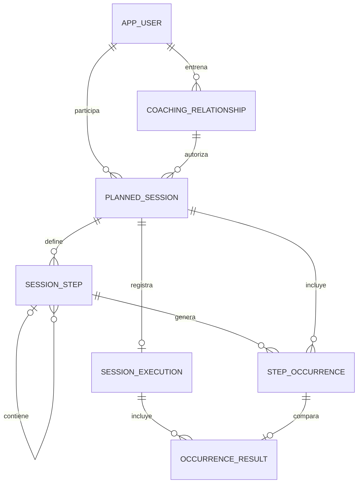

# Arquitectura de Ritmo

## Alcance implementado

Monolito modular inicial: React → API REST Spring Boot → PostgreSQL. El navegador usa Axios y en desarrollo Vite actúa como proxy. El token aleatorio vive en memoria del navegador y del proceso servidor; caduca a las ocho horas y se revoca al cerrar sesión. Las contraseñas se almacenan con BCrypt. Para pruebas locales se permite registrar entrenadores y crear atletas vinculados; las cuentas demo son opcionales. No hay recuperación de contraseña ni verificación de correo. No se generan entrenamientos ni resultados ficticios.

### Modelo relacional



La definición exacta de columnas, tipos, claves y restricciones es [schema.sql](../backend/src/main/resources/schema.sql). El dibujo resume las relaciones; `coaching_relationship` referencia dos veces `app_user`, una como entrenador y otra como atleta.

| Tabla | Propósito y claves principales |
|---|---|
| `app_user` | `id bigint` PK, nombre, correo único, hash BCrypt y rol. |
| `coaching_relationship` | `(coach_id, athlete_id)` PK y FK hacia usuarios; autoriza la asignación. |
| `planned_session` | Fecha, tipo, título, notas y FK compuesta hacia la relación entrenador–atleta. |
| `session_step` | Árbol ordenado: FK de sesión y padre, clase `GROUP`, `RUN` o `REST`, repetición y objetivos numéricos en metros y segundos. |
| `step_occurrence` | Cada aparición concreta de un paso terminal, con FK al paso y sesión, secuencia única y camino de repetición. |
| `session_execution` | Una ejecución manual por sesión: tiempo, distancia, FC, esfuerzo percibido y notas. |
| `occurrence_result` | FK a ejecución y ocurrencia, tiempo y distancia observados; PK compuesta por ambas FK. |

El servidor valida propiedad de la sesión y que cada ocurrencia pertenezca a ella antes de guardar. Las entradas se guardan en transacción. Un máximo de 500 ocurrencias y cinco niveles de pasos limita la expansión. El árbol define objetivos; las ocurrencias almacenan cada posición concreta; los resultados no sobrescriben los objetivos. Ritmo rápido y suave se guardan en segundos por kilómetro, por ejemplo `234` = 3:54 y `248` = 4:08. El ritmo medio de la sesión se calcula a partir del tiempo y la distancia totales; no se guarda un valor redundante.

Las pausas también tienen ocurrencia. Una pausa dentro de un grupo repetido ocurre en **todas** sus iteraciones, incluida la última. Para `2 × 6 × 300 m`, con 1 minuto entre repeticiones y 3 minutos entre bloques, se puede representar exactamente cada bloque como un grupo con: un subgrupo repetido 5 veces que contiene carrera y pausa de 60 s, seguido de una última carrera de 300 m; se coloca una pausa de 180 s entre los dos bloques. Esto produce 12 carreras, 10 pausas entre series y una pausa entre bloques, sin pausas adicionales.

## API

Para desarrollo local, `POST /api/auth/register-coach` crea una cuenta de entrenador y `POST /api/athletes` permite a un entrenador autenticado crear un atleta vinculado. Ambos reciben `name`, `email` y `password`; el hash se almacena con BCrypt y la contraseña se limita a 72 bytes. El alta del atleta y su vínculo son transaccionales. No hay verificación de correo, invitaciones, recuperación de contraseña ni protección ante abuso: el registro público solo está pensado para desarrollo local, no para despliegue público.

Todos los endpoints excepto login requieren `Authorization: Bearer <token>`. El entrenador solo puede consultar sus propias sesiones y asignar a atletas relacionados; el atleta solo puede ver y registrar las suyas. Las respuestas de acceso a sesiones inexistentes o ajenas son `404`. `PUT` de feedback reemplaza todo el resumen y todos los resultados previos. Se requiere al menos una medición, resultado o comentario no vacío para guardar; las cantidades decimales admiten hasta ocho dígitos enteros y dos decimales.

| Método | URI | Función |
|---|---|---|
| POST | `/api/auth/login` | Ingresar con `email` y `password`; devuelve token y usuario. |
| GET | `/api/auth/me` | Consultar usuario autenticado. |
| POST | `/api/auth/logout` | Revocar token actual. |
| GET | `/api/athletes` | Atletas asignados al entrenador. |
| GET | `/api/sessions?from=2026-11-09&athleteId=2` | Siete días desde `from`; `athleteId` es requerido para entrenador y opcional para atleta. |
| POST | `/api/sessions` | Crear una sesión para un atleta asignado. |
| GET | `/api/sessions/{id}` | Consultar objetivos, ocurrencias y ejecución. |
| PUT | `/api/sessions/{id}/feedback` | Crear o reemplazar el resultado por el atleta. |

Ejemplo completo de estructura exacta para 2 × 6 × 300 m. Sustituye `athleteId` por el ID obtenido de `/api/athletes`:

```json
{
  "athleteId": 2,
  "date": "2026-11-09",
  "title": "2 bloques de 6 × 300 m",
  "type": "INTERVALS",
  "notes": "Calentar y enfriar según indicaciones del entrenador.",
  "steps": [
    {
      "kind": "GROUP", "label": "Bloque 1", "repeatCount": 1,
      "children": [
        {"kind": "GROUP", "label": "Cinco con recuperación", "repeatCount": 5, "children": [
          {"kind": "RUN", "label": "300 m", "repeatCount": 1, "distanceM": 300, "targetDurationS": 51.9},
          {"kind": "REST", "label": "Pausa entre series", "repeatCount": 1, "targetDurationS": 60}
        ]},
        {"kind": "RUN", "label": "Últimos 300 m", "repeatCount": 1, "distanceM": 300, "targetDurationS": 51.9}
      ]
    },
    {"kind": "REST", "label": "Pausa entre bloques", "repeatCount": 1, "targetDurationS": 180},
    {
      "kind": "GROUP", "label": "Bloque 2", "repeatCount": 1,
      "children": [
        {"kind": "GROUP", "label": "Cinco con recuperación", "repeatCount": 5, "children": [
          {"kind": "RUN", "label": "300 m", "repeatCount": 1, "distanceM": 300, "targetDurationS": 51.9},
          {"kind": "REST", "label": "Pausa entre series", "repeatCount": 1, "targetDurationS": 60}
        ]},
        {"kind": "RUN", "label": "Últimos 300 m", "repeatCount": 1, "distanceM": 300, "targetDurationS": 51.9}
      ]
    }
  ]
}
```

Tras crearla, `GET /api/sessions/{id}` devuelve los IDs de las ocurrencias; nunca se deben adivinar. Ejemplo de `PUT /api/sessions/{id}/feedback`, con IDs ilustrativos que deben sustituirse por los devueltos:

```json
{
  "durationS": 2040,
  "distanceM": 7300,
  "avgHr": 154,
  "maxHr": 184,
  "rpe": 8,
  "notes": "El segundo bloque se sintió más exigente.",
  "results": [
    {"occurrenceId": 101, "durationS": 53.4, "distanceM": 300},
    {"occurrenceId": 103, "durationS": 51.9, "distanceM": 300},
    {"occurrenceId": 105, "durationS": 52.3, "distanceM": 300}
  ]
}
```

## Componentes y estado

`App` coordina usuario, atleta, semana y carga; `Login` gestiona la entrada; `CreateSession` mantiene el borrador y `StepEditor` edita recursivamente cada nodo. `SessionDetail` muestra el objetivo y permite editar el resultado. El estado del formulario está en React con actualizaciones inmutables; las claves locales de React no se envían al servidor. Axios centraliza el token en memoria. No es necesario un almacén global para esta primera versión; a medida que crezca conviene separar componentes, agregar un manejador de consultas y formularios, y mantener el estado transitorio local.

## Integraciones futuras

Todavía no hay integración ni emparejamiento automáticos. Crear adaptadores independientes por proveedor, guardar consentimiento y credenciales cifradas, obtener solo datos autorizados, renovar/revocar tokens y procesar eventos con una cola idempotente. Una actividad debe identificarse de forma única por proveedor, cuenta y ID externo. Convertir unidades y zonas horarias de forma explícita y guardar procedencia. El matching debe proponer candidatos según atleta, fecha/hora local, tipo, distancia y duración, mostrar confianza y pedir confirmación ante ambigüedad; nunca sobrescribir feedback manual silenciosamente. Mapear vueltas únicamente cuando existan y sean compatibles: no todas las actividades contienen series fiables. Separar una actividad importada de una ejecución confirmada, permitir desvincularla y resolver duplicados entre proveedores.

Strava dispone de OAuth, API y eventos webhook sujetos a sus límites, permisos y condiciones; Garmin tiene programas de desarrolladores diferentes y el acceso depende del programa y la aprobación correspondiente. Revisar elegibilidad, políticas, retención y derechos de datos antes de implementarlos:

- https://developers.strava.com/docs/authentication/
- https://developers.strava.com/docs/webhooks/
- https://developers.strava.com/docs/rate-limits/
- https://developer.garmin.com/gc-developer-program/
- https://developer.garmin.com/gc-developer-program/personal/personal-api/

## Antes de una versión pública

Implementar gestión de cuentas e invitaciones, verificación y recuperación, límites de intentos y protección ante abuso, auditoría sin datos sensibles, rotación y revocación de credenciales, sesiones persistentes seguras o proveedor de identidad, y revisión de autorizaciones por recurso. Incorporar migraciones versionadas, protección ante concurrencia y actualizaciones perdidas, copias de seguridad y recuperación, pruebas de integración PostgreSQL y pruebas de seguridad. Configurar HTTPS, cabeceras de seguridad y política de contenidos, secretos fuera del código, observabilidad, despliegue y evaluación de privacidad/consentimiento. El token en memoria y el esquema de arranque son deliberadamente de desarrollo; no garantizan disponibilidad ni seguridad de producción. Los datos de FC y esfuerzo requieren manejo especialmente cuidadoso; la aplicación no da diagnósticos ni recomendaciones médicas.

## Avances: progreso y seguridad de cuenta

El panel de progreso calcula el promedio de RPE y una carga estimada por sesión (`duración en minutos × RPE`), agregada para las sesiones filtradas con ambas mediciones. No se imputan valores ausentes; se muestra el número de observaciones y se excluyen descansos y fechas futuras. La carga es orientativa y no predice por sí misma fatiga, recuperación o lesiones.

## Ruta sugerida para un piloto privado

El Dockerfile raíz ofrece una imagen preliminar multietapa: construye React, empaqueta los estáticos en Spring Boot, ejecuta `mvn verify` y corre Java 21 sin privilegios root. `PORT` determina el puerto HTTP y `/api` comparte origen con el frontend. La ruta pública `/` sirve para una comprobación básica del proceso, no valida la base de datos. `schema.sql` sigue ejecutándose al iniciar y las cuentas y sesiones conservan las limitaciones descritas abajo. No es un despliegue de producción y falta probar la imagen junto a PostgreSQL real.

La arquitectura web actual puede ejecutarse con un frontend estático, backend Spring Boot y PostgreSQL administrado, pero todavía no es apta para usuarios reales en internet. Un proveedor como Render ofrece despliegue de servicios, base administrada y comprobaciones de estado; deben evaluarse tarifas, backups y condiciones del plan elegido. Usar entornos separados, secretos gestionados y acceso TLS, con el backend accesible desde el frontend a través de un dominio y rutas autorizadas.

Antes del piloto: registro restringido por invitación, controles contra abuso y recuperación de cuenta; credenciales y sesiones seguras y revocables; migraciones versionadas aplicables a la base existente; autorización revisada, tratamiento de datos sensibles y consentimiento; copias automáticas con prueba de restauración; monitoreo sin datos privados, alertas, manejo de errores, pruebas de integración reales con PostgreSQL, accesibilidad y pruebas de usuario. Debe definirse un plan de incidentes y borrado/exportación de datos. El servicio no debe usar cuentas demo ni depender del estado del proceso para autenticación.

El atleta autenticado puede consultar `GET /api/coaches` y registrar una sesión con `POST /api/my-sessions`, indicando `coachId` y la misma estructura que una sesión planificada. El servidor comprueba el vínculo y fija el atleta a la identidad autenticada. `PATCH /api/my-sessions/{id}/date` cambia su fecha conservando sus resultados. `DELETE /api/my-sessions/{id}` elimina una sesión propia y sus resultados, incluso si fue creada por el entrenador; la interfaz pide confirmación explícita. Es un borrado permanente que afecta las vistas del entrenador y las estadísticas. No hay papelera ni auditoría. El modelo actual no registra quién creó la sesión y requiere al menos un entrenador vinculado. El progreso usa la fecha planificada, que cambia al mover la sesión.

- `GET /api/progress?from=AAAA-MM-DD&to=AAAA-MM-DD&athleteId=...` devuelve sesiones del periodo de hasta 366 días. El atleta solo consulta las propias; el entrenador requiere vínculo y solo recibe sesiones creadas por él. La interfaz calcula sesiones con feedback, distancia registrada en carreras, tiempo, ritmo ponderado y volumen por semana. Excluye fechas futuras y descansos del porcentaje. No equivale a cumplimiento de objetivos.
- `POST /api/auth/change-password` requiere autenticación, contraseña actual y una nueva de 12 caracteres mínimo y 72 bytes máximo. Se almacena con BCrypt, se evita reemplazar simultáneamente otro cambio de contraseña y se revocan los tokens de la cuenta en la instancia actual. El cliente vuelve al inicio de sesión. Los tokens siguen en memoria: no son revocación distribuida ni una gestión de sesiones para producción.
- El historial del progreso permite abrir el detalle de cada sesión filtrada. Su fecha es la programada, no necesariamente la fecha real de ejecución.

Siguen pendientes las invitaciones, recuperación, verificación, controles ante abuso, auditoría y sesiones persistentes. También falta resolver condiciones de carrera entre inicio de sesión y cambio de contraseña, controlar actualizaciones concurrentes del feedback, incorporar migraciones y probar con PostgreSQL real. No se debe exponer esta versión a internet ni usar datos sensibles reales.
